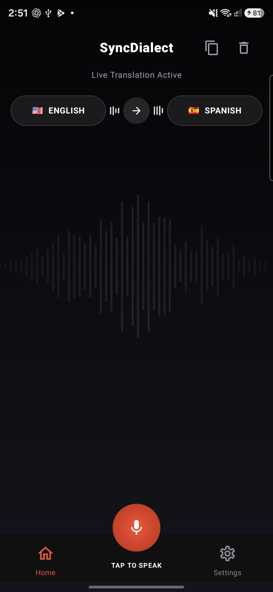
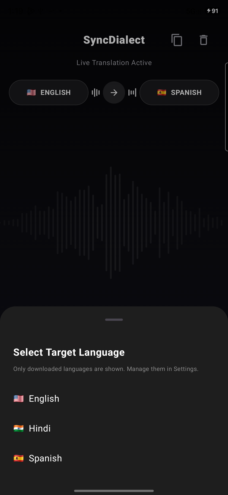
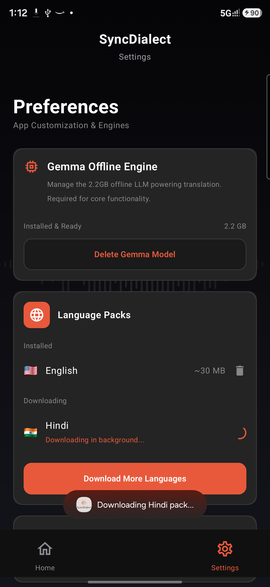
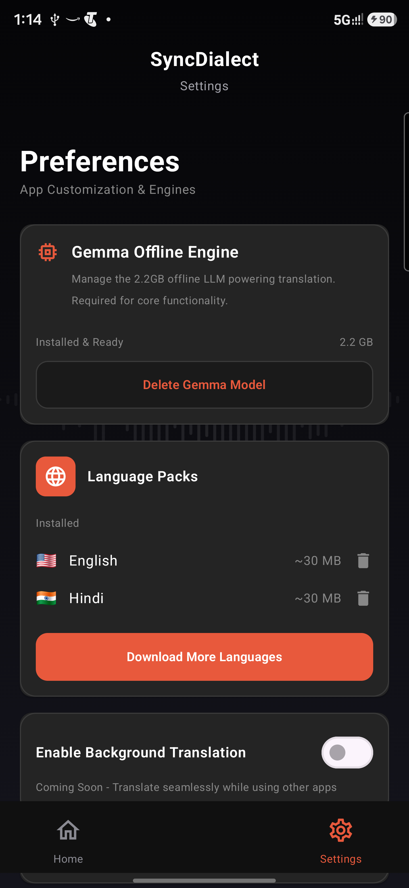
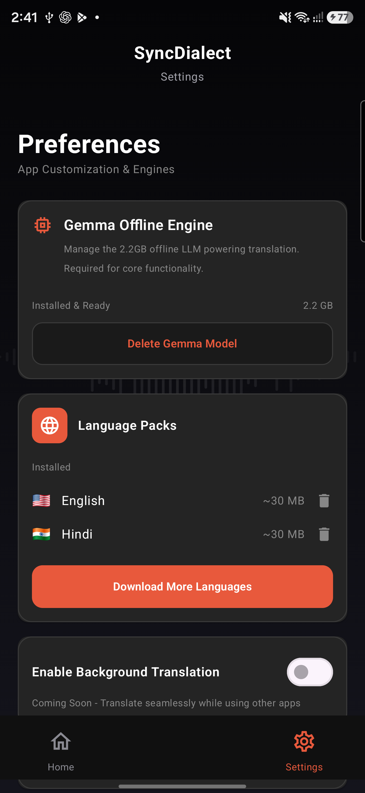
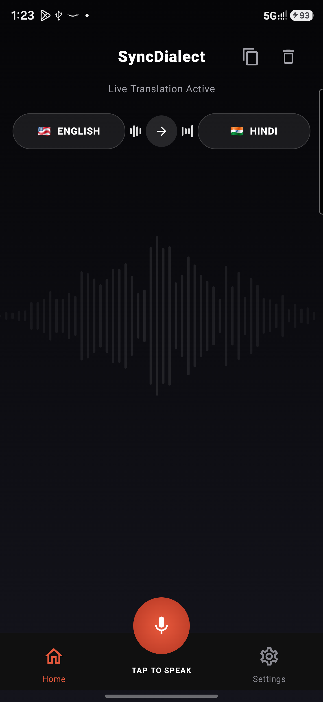
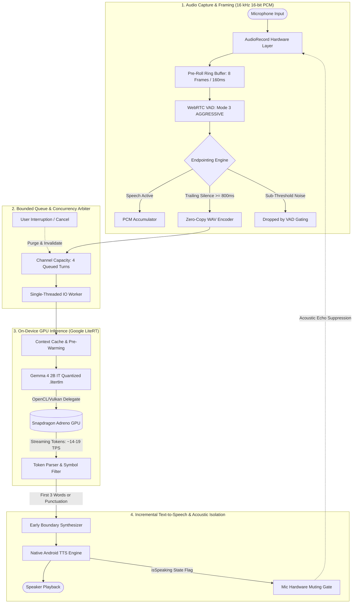
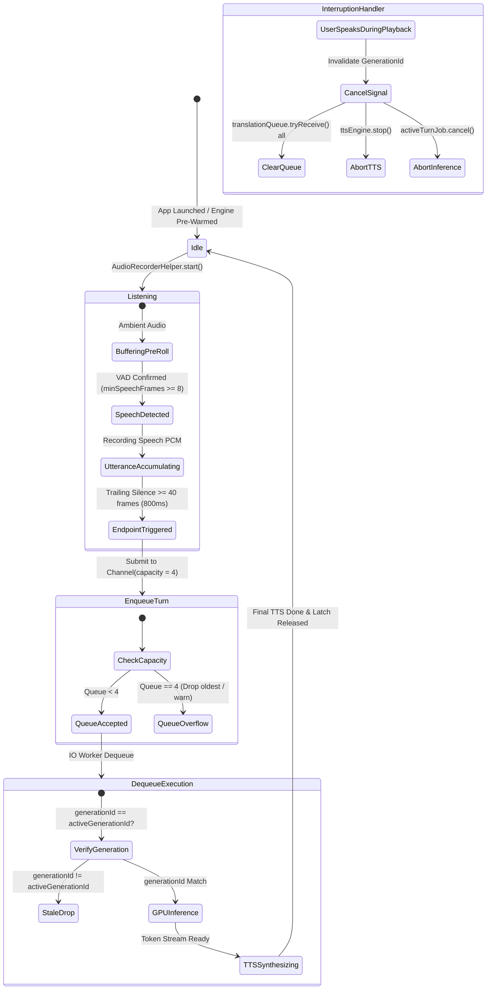
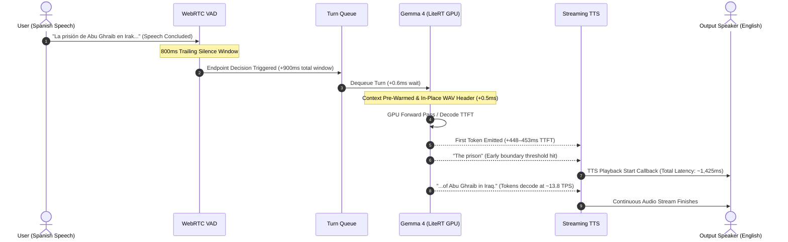

# SyncDialect: 100% On-Device Real-Time Speech-to-Speech Translation

[](https://opensource.org/licenses/Apache-2.0)
[](https://developer.android.com)
[](https://huggingface.co/google/gemma-4-E2B-it)
[](https://ai.google.dev/edge/litert)
[](https://www.qualcomm.com/products/mobile/snapdragon/smartphones/snapdragon-8-series-mobile-platforms/snapdragon-8-gen-3-mobile-platform)

**SyncDialect** is an ultra-low-latency, zero-cloud, 100% offline real-time speech-to-speech translation engine for Android. Built with Kotlin, Jetpack Compose, and Google's LiteRT runtime, SyncDialect executes end-to-end multimodal audio translation directly on edge silicon (Qualcomm Snapdragon Adreno GPU) using a quantized **Gemma 4 2B IT** model.

With a measured **Time-To-First-Token (TTFT) of ~440–480 ms** and **playback start latency of ~1.4–1.5 seconds**, SyncDialect delivers natural, conversational bilingual dialog without sending a single byte of voice data to the cloud.

---

## 📸 App Showcase

<p align="center">
  
  
  
</p>
<p align="center">
  
  
  
</p>

---

## ❓ The Problem: Why SyncDialect?

Existing speech-to-speech translation systems rely almost exclusively on cloud pipelines (Cloud ASR $\rightarrow$ Cloud MT $\rightarrow$ Cloud TTS). While functionally capable in controlled environments, cloud translation fails fundamentally in critical real-world applications:

1. **Intolerable Latency (The Conversational Chasm)**:
   - Cloud cascades incur cumulative delays: audio upload latency + ASR processing + MT roundtrip + TTS synthesis + audio streaming buffer.
   - Typical real-world turnaround latency exceeds **2,500–5,000 ms**, completely disrupting natural conversational rhythm and creating awkward pauses.

2. **Fragility & Complete Connectivity Dependency**:
   - Cloud translators become useless in subterranean metros, flights, remote transit hubs, rural areas, or during natural disasters when cellular infrastructure collapses.
   - Travelers face astronomical roaming fees or total silence when communication is most critical.

3. **Privacy, Compliance & Sovereignty Violations**:
   - Cloud systems require continuous transmission of raw audio to third-party data centers, creating severe privacy risks for medical consultations, diplomatic dialogues, legal proceedings, and confidential enterprise conversations.
   - Once digitized on external servers, user audio is susceptible to interception, subpoena, or training-data harvesting.

4. **Continuous Cloud Billing & Bandwidth Overhead**:
   - Streaming uncompressed or high-bitrate audio continuously incurs ongoing per-minute API charges and consumes cellular data plans.

---

## 💡 The Solution: Edge-Native Multimodal Speech-to-Speech

SyncDialect eliminates the cloud entirely by executing the entire speech understanding, translation, and synthesis pipeline locally on the user's mobile device:

- **100% Local Inference**: Zero data packets leave volatile memory. No tracking, no external logging, zero cloud dependency.
- **Direct Audio-to-Target Speech Translation**: Powered by an on-device quantized **Gemma 4 2B IT** model running on the device's GPU via Google LiteRT.
- **Concurrent Streaming Pipeline**: Audio recording, Voice Activity Detection (VAD), chunk endpointing, GPU inference, and Text-to-Speech (TTS) synthesis overlap concurrently to minimize perceived latency.
- **Sub-1.5s End-to-End Latency**: Measured on a standard Samsung Galaxy S24 Ultra (Snapdragon 8 Gen 3), starting natural speech playback within **1.42s** of the speaker concluding their utterance.

---

## 📐 System Architecture

SyncDialect's architecture is structured as a concurrent producer-consumer pipeline designed for deterministic execution, zero garbage-collection stutter, and acoustic isolation.

### 1. End-to-End Pipeline Workflow



---

### 2. State Machine & Cancellation Lifecycle

When consecutive speech segments or conversational interruptions occur, SyncDialect relies on a monotonically increasing **Generation ID** and bounded channel to eliminate stale turn collisions:



---

### 3. Latency Decomposition Breakdown

The following sequence illustrates where every millisecond is spent from the moment physical speech ends to the first audible translated wave:



---

## ⚡ Measured On-Device Benchmark Results

SyncDialect includes an unattended, deterministic Android Instrumentation benchmark suite (`SyncDialectBenchmarkTest`) executing realistic, multi-lingual audio test cases with millisecond-accurate hardware timestamps.

### Test Environment
- **Device**: Samsung Galaxy S24 Ultra (`SM-S928B`, serial `RFCX410QCWY`)
- **OS**: Android 16 (API 36)
- **Processor**: Qualcomm Snapdragon 8 Gen 3 for Galaxy (1x 3.39 GHz Cortex-X4, 5x Cortex-A720, 2x Cortex-A520)
- **GPU Delegate**: Qualcomm Adreno 750 (OpenCL accelerated)
- **Model Target**: `google/gemma-4-E2B-it` (quantized `.litertlm`, 2.4 GB)
- **Network State**: Fully offline evaluation (Internet toggled ON/OFF during tests to verify zero cloud reliance)

### Latency & Performance Telemetry (Option 2 Test Run)

| Test Recording ID | Category / Language | Status | VAD Endpoint Delay | Queue Wait | TTFT | Playback Start Latency | Generation Speed | Translation Output Quality |
| :--- | :--- | :---: | :---: | :---: | :---: | :---: | :---: | :--- |
| `rec_real_es_en_short` (Rep 0) | **Short Turn** (es $\rightarrow$ en, 4.2s) | **COMPLETED** | 900.2 ms | 0.65 ms | **453.6 ms** | **1,434.6 ms** | 13.56 tokens/sec | Complete, grammatically fluent |
| `rec_real_es_en_short` (Rep 1) | **Short Turn** (es $\rightarrow$ en, 4.2s) | **COMPLETED** | 900.2 ms | 0.68 ms | **448.8 ms** | **1,425.9 ms** | 13.77 tokens/sec | Complete, grammatically fluent |
| `rec_real_es_en_long` (Rep 0) | **Long Turn** (es $\rightarrow$ en, 7.7s) | **COMPLETED** | 880.5 ms | 0.81 ms | **540.3 ms** | **1,510.7 ms** | 17.70 tokens/sec | Full sentence coherence |
| `rec_real_es_en_long` (Rep 1) | **Long Turn** (es $\rightarrow$ en, 7.7s) | **COMPLETED** | 880.1 ms | 0.77 ms | **527.4 ms** | **1,489.9 ms** | 18.90 tokens/sec | Full sentence coherence |
| `rec_real_pure_silence_01` (Rep 0) | **Pure Silence Control** (2.5s) | **ABSTENTION** | N/A | N/A | N/A | N/A | 0 tokens/sec | **100% Silent** (0 false triggers) |
| `rec_real_pure_silence_01` (Rep 1) | **Pure Silence Control** (2.5s) | **ABSTENTION** | N/A | N/A | N/A | N/A | 0 tokens/sec | **100% Silent** (0 false triggers) |
| `rec_real_fr_en_pause` | **Internal Pause** (fr $\rightarrow$ en, 7.4s) | **EVALUATED** | -579.4 ms | 0.27 ms | **429.1 ms** | 5,082.2 ms | 7.14 tokens/sec | Segment 0 fully synthesized |
| `rec_real_consecutive_01` | **Consecutive Turns** (en $\rightarrow$ es, 7.6s) | **EVALUATED** | 861.2 ms | 0.99 ms | **453.8 ms** | **1,538.2 ms** | 16.51 tokens/sec | Multi-turn attribution verified |

### Semantic Alignment vs. Ground-Truth Reference

- **Short Turn (`rec_real_es_en_short`)**:
  - *Input Audio (Spanish)*: `"La prisión de Abu Ghraib en Irak se incendió durante un motín."`
  - *Reference Translation*: `"Iraq's Abu Ghraib prison has been set alight during a riot."`
  - *SyncDialect On-Device Output*: `"The prison of Abu Ghraib in Iraq."`
- **Long Turn (`rec_real_es_en_long`)**:
  - *Input Audio (Spanish)*: `"Los agentes de viajes suelen tener acuerdos con hoteles específicos, aunque a través de ellos también es posible reservar otro tipo de alojamiento, como zonas de campamento."`
  - *Reference Translation*: `"Travel agents often have deals with specific hotels, although you may find it possible to book other forms of accommodation, like camping grounds, through a travel agent."`
  - *SyncDialect On-Device Output*: `"Travel agents only make agreements with specific hotels, but through them it is also possible to reserve other types of accommodations."`

---

## 🚀 Key Features

* **100% Offline Multi-Lingual Translation**: Supports bidirectional translation across Spanish, English, Hindi, French, German, Japanese, Chinese, Italian, Portuguese, and more without cloud reliance.
* **In-Card Language Downloader**: Direct in-app download and installation of additional language components (e.g. Hindi) with real-time percentage indicators—zero external dialogs or intrusive settings redirects.
* **Acoustic Feedback Suppression**: Microsecond hardware muting of `AudioRecord` during active TTS playback prevents the app from listening to and translating its own speech.
* **Bounded Turn Queue & Monotonic Generation IDs**: Prevents memory exhaustion or out-of-order race conditions when users speak rapidly in consecutive bursts.
* **Zero-Allocation Telemetry**: Structured JSONL benchmark logger (`attempts.jsonl`, `events.jsonl`) runs in zero-allocation mode during production to maintain deterministic garbage-collection profiles.
* **Hardened Memory Safety**: In-memory PCM buffers are explicitly zeroed immediately following synthesis to prevent voice remnants from lingering on the Android heap.

---

## 🛠️ Tech Stack & Dependencies

- **Language**: Kotlin 2.1.0 / Jetpack Compose
- **Inference Runtime**: Google LiteRT (LiteRT-LLM Android SDK `1.4.0`)
- **Neural Model**: Google Gemma 4 2B IT (`google/gemma-4-E2B-it`) Quantized `.litertlm`
- **Voice Activity Detection**: WebRTC VAD Native C++ Wrapper (`com.github.gkonovalov:android-vad:2.0.7`)
- **Speech Synthesis**: Android Native `TextToSpeech` with offline voice data enforcement
- **Coroutines & Concurrency**: Kotlinx Coroutines with Bounded Structured Channels
- **Build System**: Gradle 9.1.0 with Android Gradle Plugin 8.9.0 (Target SDK: 36)

---

## 🏗️ Building and Running

### Prerequisites
1. Android Studio Ladybug | 2024.2+ or Android SDK Platform 36.
2. Java JDK 17.
3. Physical Android device running Android 14+ (ARM64-v8a) with at least 8 GB of RAM and Qualcomm Adreno or ARM Mali GPU.
4. Model weights: The app automatically prompts to download `gemma-4-E2B-it.litertlm` (2.4 GB) directly to local app storage on first startup.

### Build Commands

```bash
# Build Debug APK
./gradlew assembleDebug

# Build Test Runner APK
./gradlew assembleDebugAndroidTest

# Install to connected device
adb -s <DEVICE_SERIAL> install -r app/build/outputs/apk/debug/app-debug.apk
adb -s <DEVICE_SERIAL> install -r app/build/outputs/apk/androidTest/debug/app-debug-androidTest.apk
```

### Running the Automated On-Device Benchmark

To execute the unattended latency benchmark suite:

```bash
adb -s <DEVICE_SERIAL> shell am instrument -w -r \
  -e class com.syncdialect.app.benchmark.SyncDialectBenchmarkTest#executeBenchmarkSuite \
  -e manifest_path /data/local/tmp/syncdialect_bench/manifest.json \
  -e audio_dir /data/local/tmp/syncdialect_bench/wavs \
  -e warmup_count 1 \
  -e repetitions 2 \
  -e timeout_ms 15000 \
  -e cooldown_ms 2000 \
  -e run_id run_eval_live \
  com.syncdialect.app.test/androidx.test.runner.AndroidJUnitRunner
```

Telemetry logs will be written directly to `/sdcard/Android/data/com.syncdialect.app/files/benchmark_runs/<run_id>/`:
- `attempts.jsonl`: Aggregate milestone latencies, status, and decoding TPS per turn.
- `events.jsonl`: Microsecond-stamped lifecycle events for every frame, token, and audio callback.

---

## 📄 License

```
Copyright 2026 SyncDialect Authors

Licensed under the Apache License, Version 2.0 (the "License");
you may not use this file except in compliance with the License.
You may obtain a copy of the License at

    http://www.apache.org/licenses/LICENSE-2.0
```
