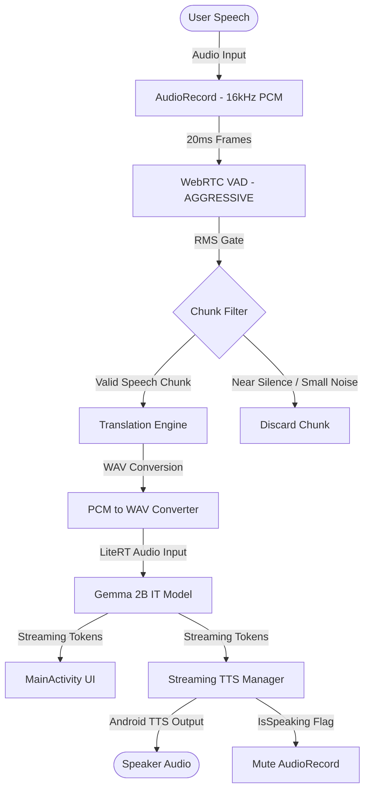

# SyncDialect

SyncDialect is a high-performance, 100% offline, real-time voice translation Android application built with Kotlin and Jetpack Compose. By leveraging Google LiteRT (formerly MediaPipe LLM Inference API) and the Gemma 2B IT audio-multimodal model on-device, SyncDialect provides instantaneous voice-to-voice translation without relying on cloud servers.

With an average end-to-end delay/latency of **600–800 ms**, SyncDialect is one of the fastest—if not the only fastest—offline voice real-time translators available.

---

## 📐 System Architecture

The following diagram illustrates the flow of audio processing, speech segmentation, translation, and Text-to-Speech synthesis:



---

> [!TIP]
> For an in-depth breakdown of engine hyperparameters, audio framing, WebRTC VAD thresholds, concurrency model, and latency optimization logs, see **[techstack.md](techstack.md)**.

---

## 🚀 Key Features

*   **Ultra-Low Latency**: Achieves real-time translation with a delay of only **600–800 ms**, enabling natural flow in bilingual conversations.
*   **100% Offline & Private**: Runs entirely local on-device. No audio data, transcribed text, or translations are uploaded to the cloud, ensuring complete data privacy.
*   **Advanced Voice Activity Detection (VAD)**: Employs a low-latency WebRTC VAD system to detect natural pauses in speech and automatically trigger translations.
*   **Acoustic Loop Prevention**: Integrates active feedback protection by automatically muting the microphone input while the Text-to-Speech (TTS) engine is playing translation outputs.
*   **Foreground Download Service**: Implements a robust foreground service to download the model weight file directly from Hugging Face with auto-resume on network drops and redirect management.
*   **Premium Material 3 UI**: Features a sleek, modern dark-mode aesthetic with custom-drawn canvas waveforms and dynamic user interfaces.

---

## 🛠️ Codebase Structure

*   `app/src/main/java/com/syncdialect/app/`
    *   **[MainActivity.kt](app/src/main/java/com/syncdialect/app/MainActivity.kt)**: Application coordinator. Handles the Jetpack Compose UI state, navigation, permission requests, and coordinates translation triggers.
    *   **[TranslationEngine.kt](app/src/main/java/com/syncdialect/app/TranslationEngine.kt)**: Interfaces with the LiteRT model engine, converts raw PCM audio into WAV format on-the-fly, and feeds it into the Gemma 2B IT model.
    *   **[AudioRecorderHelper.kt](app/src/main/java/com/syncdialect/app/AudioRecorderHelper.kt)**: Manages recording from the microphone, frame slicing, WebRTC VAD analysis, and energy gating.
    *   **[StreamingTTSManager.kt](app/src/main/java/com/syncdialect/app/StreamingTTSManager.kt)**: Buffers translation tokens and streams speech synthesis through the Android native TTS API.
    *   **[ModelDownloadService.kt](app/src/main/java/com/syncdialect/app/ModelDownloadService.kt)**: Handles large-file HTTP downloads in the background with WakeLock protection.
    *   **[SettingsScreen.kt](app/src/main/java/com/syncdialect/app/SettingsScreen.kt)**: Provides controls for language management, offline model updates, and speech speed adjustment.

---

## 🏗️ Compiling and Running the App

### Prerequisites
*   Android SDK (compileSdk = 36)
*   Java JDK 17
*   The application requires the Gemma model weight file (`gemma-4-E2B-it.litertlm`) placed under the app's files directory. The app contains a built-in download screen to retrieve this on first startup.

### Build Commands
Compile the app directly from your terminal using Gradle:

*   **Build Debug APK**:
    ```bash
    ./gradlew assembleDebug
    ```
*   **Compile Release AAB (Android App Bundle)**:
    ```bash
    ./gradlew :app:bundleRelease
    ```
*   **Compile Debug AAB**:
    ```bash
    ./gradlew :app:bundleDebug
    ```

*Note: Release bundles are signed using the signing keys specified in `app/build.gradle.kts`.*

---

## 💡 Performance Optimization & Future Roadmap Suggestions

> [!IMPORTANT]
> For the complete architectural assessment, measured latency decomposition, baseline corrections, and prioritized delivery sequence, see the full **[SyncDialect V2 Proposal](V2_PROPOSAL.md)**.

Based on architectural reviews and pipeline profiling, the following improvements are planned to optimize speech-end-to-first-audio latency (targeting **p50 ≤ 1.2s** and **p95 ≤ 2.0s** on flagship hardware, with sub-200ms potential via NPU acceleration):

### 1. ⚡ Latency & Pipeline Optimizations
* **Adaptive Voice Activity Detection (VAD)**:
  * *Current:* Fixed 40 frames (800 ms) silence wait time across all utterances.
  * *Proposed:* Adaptively drop the silence threshold to **20 frames (400 ms)** when speech duration exceeds 1.5s with a falling energy profile. Shaves **~300–400 ms** off perceived delay.
* **Background Conversation Pre-Warming**:
  * *Current:* `createConversation()` is called synchronously after audio is captured (~50–150 ms overhead).
  * *Proposed:* Pre-create and cache the next LiteRT `Conversation` in the background as soon as speech starts (`speechFrames >= 5`), claiming it with 0 ms overhead when audio finalizes.
* **Direct Background TTS Streaming Channel**:
  * *Current:* Every token hops to the Android Main thread via `withContext(Dispatchers.Main)` before reaching TTS.
  * *Proposed:* Stream tokens directly via a background `Channel<String>` to `StreamingTTSManager`, batching UI recompositions to eliminate Main Looper stalls (**~30–50 ms saved**).
* **Early Sentence Boundary Synthesis**:
  * *Current:* Buffers up to 8 words / 40 characters before triggering speech.
  * *Proposed:* For the very first clause, dispatch speech immediately upon receiving **3 words or a comma**, reducing Time-To-First-Sound (TTFS) by **~150 ms**.
* **Zero-Copy In-Place WAV Framing**:
  * *Current:* Allocates separate byte arrays and uses `System.arraycopy` to build the 44-byte WAV header per chunk.
  * *Proposed:* Pre-allocate a 44-byte offset in the recording stream buffer to construct WAV headers in-place, eliminating GC allocations.

### 2. 🧠 Model & Architecture Upgrades (2026 Edge AI Landscape)
* **Upgrade to Gemma 3n (Int4 Quantized)**:
  * Transition from the ~2.5 GB Int8 model to **Gemma 3n INT4** (`gemma-3n-E2B-it-int4.litertlm`).
  * *Benefits:* Shrinks model size from ~2.5 GB to **~1.4–1.8 GB** (faster download and lower RAM usage) and boosts CPU token throughput by ~25–35%.
* **Qualcomm NPU / QNN Hardware Acceleration**:
  * Enable Qualcomm QNN / MediaTek Neuropilot NPU backend delegates in LiteRT.
  * *Benefits:* Offloading LLM inference from CPU to NPU can reduce latency to **sub-200 ms** while reducing battery consumption by over 50%.
* **Dual-Tier Cascaded Mode (For Low-End Devices)**:
  * Optional ultra-battery mode using a lightweight STT (Moonshine / Whisper-Base ONNX) + offline ML Kit translation (~150 MB total memory footprint).

### 3. 🛡️ Security, Privacy & Reliability Concerns & Hardening

The security and privacy audit identified several critical items to address:

* **Missing Model Checksum (SHA-256) Verification (Tampering / MITM Risk)**:
  * *Concern:* `ModelDownloadService` downloads the 2.5 GB model binary directly over HTTPS and saves it without verifying cryptographic signatures or hashes. If a mirror is compromised or download is corrupted, invalid or poisoned weights could be executed by LiteRT.
  * *Fix:* Compute and enforce SHA-256 hash comparison against a pinned trusted hash prior to renaming the file to `.litertlm`.
* **Global Uncaught Crash Swallowing (`NoSuchMethodError`)**:
  * *Concern:* `MainActivity.onCreate()` registers a global `Thread.setDefaultUncaughtExceptionHandler` that catches and silently drops `NoSuchMethodError` (`close$default`). Silently suppressing ABI mismatch crashes leaves coroutines in unknown corrupt states and hides severe runtime errors.
  * *Fix:* Resolve Kotlin coroutine ABI dependencies (`kotlinx-coroutines` vs `litertlm-android`) in `build.gradle.kts` and eliminate the global exception suppression hook.
* **In-Memory Audio Buffer Residuals (Data Privacy)**:
  * *Concern:* While the primary audio stream array is zeroed out on flush, intermediate arrays (`ByteArray(frameSizeBytes)`) and chunk clones remain on the heap until garbage collected, theoretically exposing voice snippet remnants to memory dumps.
  * *Fix:* Implement an explicit memory-scrubbing ring buffer pattern where all allocated audio frames are zeroed immediately upon consumption.
* **Unbounded WakeLock & Battery Drain Vector**:
  * *Concern:* `ModelDownloadService` acquires a `PARTIAL_WAKE_LOCK` for up to 10 minutes unconditionally, bypassing Android battery optimization (Doze mode) even when cellular data is metered or dropping.
  * *Fix:* Replace raw foreground services and WakeLocks with Jetpack `WorkManager` using `Constraints.Builder().setRequiredNetworkType(NetworkType.UNMETERED)` to protect user battery and data plans.
* **Unmanaged Hardware Audio Thread Lifecycle**:
  * *Concern:* `AudioRecorderHelper` manages microphone capture using a raw `Thread { ... }`. If the app crashes or the process is killed abnormally, the native `AudioRecord` hardware handle may not release promptly.
  * *Fix:* Wrap microphone capture in structured Kotlin coroutine scopes with cancellation handlers ensuring atomic `audioRecord.release()`.

