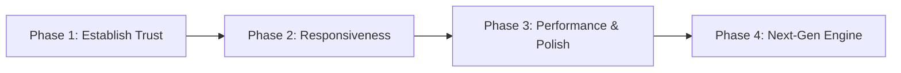

# SyncDialect V2: Architectural Review & Implementation Proposal

**Date:** 5 September 2026  
**Status:** Approved Roadmap / Implementation Reference  
**Applies to:** Core pipeline (`AudioRecorderHelper`, `TranslationEngine`, `StreamingTTSManager`), App Lifecycle (`MainActivity`), Download subsystem (`ModelDownloadService`), and documentation (`README.md`, `techstack.md`).

---

## Executive Assessment

SyncDialect provides private, on-device spoken translation without cloud dependency. The existing pipeline—combining microphone capture, WebRTC VAD speech detection, LiteRT-LM audio-multimodal inference, streamed tokens, and native TTS playback—is a solid foundation.

**The primary objective for V2 is making SyncDialect a reliable, measurable conversation translator before adding new features.** Quicker turn-taking, complete sentence translations without silent drops, dependable offline voice enforcement, and robust model management take priority over unsubstantiated speed claims.

---

## 1. Baseline Correction & Documentation Truths

Before measuring or optimizing, the repository documentation and code claims must be brought into strict agreement:

| Topic | Current State & Code Evidence | V2 Requirement |
|---|---|---|
| **End-to-End Latency** | The timer in `TranslationEngine` starts after conversation creation and WAV construction, ending at the first token. It excludes endpoint waiting (800ms) and TTS startup. `techstack.md` reports 700–1300ms TTFT. | Disclose **first-token latency** and **speech-end-to-first-audio latency** separately with device model, exact model hash, sample count, and p50/p90/p95 percentiles. Remove claims of "fastest" until backed by reproducible benchmarks. |
| **Active Prewarming** | `prewarmConversation()` in `TranslationEngine.kt` is currently a no-op stub. | Document shipped behavior accurately. Profile native session allocation costs before restoring prewarming. |
| **Model Identity** | Files oscillate between Gemma 2B, Gemma 3n proposals, and `gemma-4-E2B-it.litertlm`. Size estimates vary from 2.2GB to 2.5GB. | Pinned model metadata: exact repository revision, quantization format, SHA-256 hash, byte size, and required LiteRT-LM runtime version. |
| **CPU vs Audio Backend** | `buildEngine()` explicitly sets `audioBackend = Backend.CPU()`, but leaves the main engine `backend` implicit. | Explicitly configure and record both audio executor and LLM executor backends. |
| **Offline TTS Enforcement** | Offline TTS is the default preference, but voice fallback logic can still pick a network-dependent voice. | Strict policy: reject network-dependent voices in offline mode. If missing, fall back to text and prompt the user to download the offline voice pack. |
| **Audio Chunk Math** | At 16 kHz, Mono, 16-bit PCM: 32,000 bytes = 1.0 second. `minChunkBytes = 16000` is 0.5s (not 1.0s as commented); `96000` is 3.0s. | Code comments and benchmarks must reflect exact sample math. |

---

## 2. End-to-End Measurement Framework

### The Perceived Latency Sequence
For pause-triggered speech turns, true user-perceived delay comprises:
```text
Last spoken sample
  → VAD endpoint decision (silence wait)
  → Engine admission & conversation setup
  → WAV audio packaging & LiteRT inference
  → First safe translated phrase/boundary
  → Android TTS submission
  → First audible sound output (speaker)
```

$$\text{Speech-End-to-First-Audio} = t_{\text{endpoint}} + t_{\text{queue}} + t_{\text{setup}} + t_{\text{TTFT}} + t_{\text{first\_phrase}} + t_{\text{TTS\_startup}}$$

*With an 800ms silence wait and historical 700–1300ms TTFT, speech-end-to-first-audio was realistically 1.5–2.2 seconds before TTS audio startup.*

### Required Telemetry & Metrics
Instrument all audio chunks with a UUID and monotonic nanosecond timestamps (`SystemClock.elapsedRealtimeNanos()`):
1. **Audio Timestamps:** Last voice sample time, segment completion time, queue ingress time, and engine admission time.
2. **Inference Timestamps:** Conversation creation duration, WAV synthesis duration, Time-to-First-Token (TTFT), first speakable phrase boundary time, and total generation completion.
3. **Playback Timestamps:** `TextToSpeech.speak()` call time, `UtteranceProgressListener.onStart` event time, audio completion time, and cancellation events.
4. **Health Metrics:** Discarded chunk counts, microphone-muted duration, thermal throttling state, and RAM usage over sustained sessions.

### V2 Benchmark Targets
* **Speech-End-to-First-Audio (Flagship, short turns):** $p50 \le 1.2\text{ s}$, $p95 \le 2.0\text{ s}$
* **Zero Silent Audio Loss:** No speech chunk dropped without explicit user notification.
* **Sustained Reliability:** 20+ minute uninterrupted conversation without deadlock, memory leaks, or thermal stalling.

---

## 3. Prioritized Performance Improvements

### A. Adaptive VAD Endpointing (Highest Latency Impact)
* **Problem:** Default wait of 40 frames ($40 \times 20\text{ ms} = 800\text{ ms}$) adds nearly a full second of idle silence before inference begins.
* **V2 Implementation:**
  * Adopt an adaptive profile: drop silence threshold to **350–500 ms** when speech duration exceeds 1.5s with a smoothed falling energy profile.
  * Retain 600–800 ms allowance for short or hesitant speech (<1.0s).
  * Add **100–200 ms audio pre-roll** ring buffer to avoid clipping speech onsets before VAD triggers.
  * Provide an explicit manual **"Translate Now"** button so users can instantly trigger translation without waiting for silence.

### B. Language-Aware Early TTS Output
* **Problem:** Current buffer waits for 8 words or 40 characters or punctuation. A rigid word count fails for Asian scripts (CJK) and non-space languages.
* **V2 Implementation:**
  * Dispatch speech on the **first safe syntactic boundary** (3–5 complete words or comma/clause marker) for the initial phrase, switching to larger chunks for subsequent clauses to ensure natural prosody.
  * Serialize token buffering, TTS dispatch, and stop operations under a single state-machine owner.
  * Stream tokens to TTS via a background channel while batching UI state updates on the Main dispatcher every 30–50ms.

### C. Remove Artificial Splash & Launch Gates
* **Problem:** `MainActivity` unconditionally holds the splash screen for 4.0 seconds (`delay(4000)`).
* **V2 Implementation:** Dismiss splash as soon as the initial UI layout is drawn. Display model initialization progress and voice readiness status dynamically within the main view.
* Generate Android Baseline Profiles for cold launch, language picker, and transcript scrolling.

### D. Zero-Allocation Audio Buffering
* Avoid repeated re-allocation of `ByteArrayOutputStream` and intermediate WAV copy buffers.
* Pre-allocate a bounded PCM ring buffer and reserve 44 bytes at the head for in-place WAV header writing, reducing garbage collection pauses.

---

## 4. Completeness & Pipeline Reliability

### Eliminate Silent Audio Loss
* **Explicit Turn-Taking:** Implement a 4-state visual coordinator:
  $$\text{Listening} \longrightarrow \text{Translating} \longrightarrow \text{Speaking} \longrightarrow \text{Ready}$$
* **Stop Action:** Add a prominent "Stop speaking and listen" button that halts TTS playback, resets audio state, and re-enables the microphone immediately.
* **Bounded Audio Queue:** Allow at most 1 queued segment during active translation. If the queue overflows, alert the user visually ("*Speech missed, please repeat*") instead of discarding data silently.

### Bug Fixes & Text Integrity
1. **Fix Greedy String Sanitizer:** The current `sanitize()` removes substrings like `"turn"`, `"model"`, and `"user"`, corrupting words like `"return"`. Replace with an exact regex token stripper targeting only literal model control tokens.
2. **Remove Hard 300-Char Limit:** Replace `takeWhile { charCount < 300 }` with engine-level token budgets and visual continuation indicators for truncated output.
3. **Language Snapshotting:** Snapshot `sourceLang`, `targetLang`, and `targetVoice` at the exact moment an audio chunk is accepted. Prevent UI language changes from altering in-flight translations mid-stream.
4. **Clear TTS Buffers on Stop:** When user taps Stop or switches modes, flush pending `StringBuilder` text, queued utterances, and watchdog timers synchronously.

### Pipeline Lifecycle Architecture
* Consolidate capture, inference, and playback under a dedicated `TranslationSessionController` / `ViewModel`.
* Ensure `TranslationEngine.close()` is invoked deterministically on activity teardown.
* When inference throws an error, reset the recording hardware and UI state simultaneously.

---

## 5. Enforceable Privacy & Offline Integrity

* **Strict Offline Voice Check:** Query `Voice.isNetworkConnectionRequired`. When offline mode is active, reject cloud-dependent voices. If no local voice exists, notify the user and offer a direct intent to Android Speech Settings.
* **Remove Spoken Text from Routine Logs:** `StreamingTTSManager.speak()` must not print user translation text to system logcat. Retain only segment UUIDs and timing metrics.
* **True Buffer Zeroing:** Overwrite the backing store of reusable audio buffers immediately upon handoff, rather than zeroing ephemeral `.toByteArray()` copies.

---

## 6. Model Download & Setup Architecture

* **Versioned Model Manifest:** Distribute a signed JSON manifest specifying:
  * Model filename and download URL.
  * Expected file size and SHA-256 hash.
  * Minimum supported LiteRT-LM runtime version.
* **Download Integrity & Recovery:**
  * Validate SHA-256 hash before renaming temporary downloads (`.tmp` $\to$ `.litertlm`).
  * Check the boolean return of `renameTo()`.
  * Support resume with `Range` and `If-Range` headers.
  * Preserve previous working model until the replacement passes integrity validation.
  * Offer an explicit user toggle: **"Download on Wi-Fi Only"**.
* **Android 14+ Data Transfer:** Use user-initiated jobs on Android 14+ for large multi-gigabyte transfers with progress notifications.
* **Dependency Pinning:** Pin `litertlm-android` and `kotlinx-coroutines` to verified binary-compatible versions. Eliminate the global `NoSuchMethodError` catch-all in `MainActivity`.

---

## 7. Model Evaluation Strategy (2026 Edge AI)

| Candidate Model | Evaluation Rationale | Required Validation Gates |
|---|---|---|
| **Gemma 4 E2B IT (Current)** | Zero migration cost; stable baseline. | Comprehensive p50/p95 timings, memory footprint, long-session thermal stability. |
| **Gemma 3n Int4 (`gemma-3n-E2B-it-int4`)** | Smaller footprint (~1.4–1.8GB) and faster Int4 CPU execution. | Verify LiteRT-LM task packaging, translation fidelity, and actual RAM usage. |
| **Hardware NPU Delegation (Qualcomm QNN / HTP)** | Sub-200ms potential; significantly reduced battery drain. | Test on supported chipsets (Snapdragon 8 Gen 2/3/4); require seamless CPU fallback. |
| **Cascaded Pipeline (Moonshine/Whisper + ML Kit)** | Low-end fallback (~150MB total footprint). | Benchmark transcription word error rate (WER) propagation into translated output. |

---

## 8. Delivery Roadmap & Phases



### Phase 1: Establish Trust & Correctness
- [ ] Implement nanosecond latency telemetry framework across all stages.
- [ ] Enforce strict offline TTS voice filtering.
- [ ] Fix string sanitizer bug (stop stripping `"turn"`/`"user"` from actual words).
- [ ] Resolve coroutine ABI compatibility and remove global crash handler.
- [ ] Add SHA-256 model verification and atomic file promotion.

### Phase 2: Responsiveness & UI Flow
- [ ] Implement adaptive VAD silence detection (400ms target for long speech).
- [ ] Add 150ms audio pre-roll buffer.
- [ ] Language-aware first-phrase TTS dispatch.
- [ ] Remove 4-second artificial splash screen delay.
- [ ] Add explicit manual "Translate Now" control and visual turn-state indicators.

### Phase 3: Performance & Memory Stabilization
- [ ] Zero-copy in-place WAV header assembly.
- [ ] Reusable PCM audio ring buffer with verified memory scrubbing.
- [ ] Extract `TranslationSessionController` / ViewModel architecture.
- [ ] Add Wi-Fi only model download preference and download resume verification.
- [ ] 20-minute continuous conversation thermal/battery stress test.

### Phase 4: Model Exploration & Hardware Acceleration
- [ ] Benchmark Gemma 3n Int4 model against baseline test corpus.
- [ ] Evaluate Qualcomm QNN NPU backend delegate on supported devices.
- [ ] Prototype cascaded Moonshine + ML Kit pipeline for budget devices.
